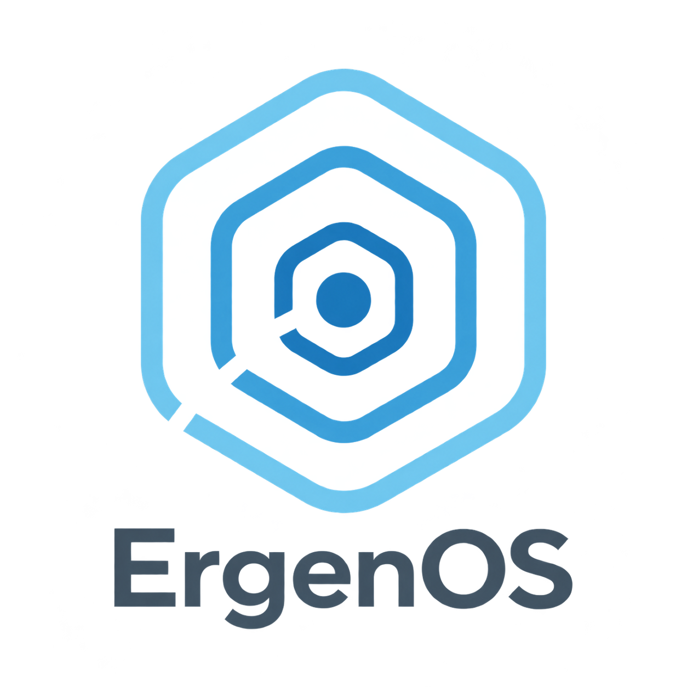

# ErgenOS Welcome

<p align="center">
  
</p>

[](https://github.com/ErgenosSW/ErgenOS-Welcome/tree/v1.0.3)
[](LICENSE)

ErgenOS Welcome is the welcome application included with [ErgenOS](https://github.com/ErgenosSW/ErgenOS-Linux).

It opens the installer in the live environment and provides quick access to ErgenPac, ErgenCTL, the official ErgenOS website, ErgenOS Wiki and project resources. Online links follow the desktop language (English or Polish). Automatic startup can be disabled from the application.

## Version 1.0.3 in ErgenOS 1.2

The redesigned welcome portal uses the shared ErgenOS visual style, a custom
header, action tiles and system information. Version 1.0.2 introduced language-aware
website/Wiki resources; 1.0.3 brings the visual redesign. The ten-test suite passed
during release preparation.

Welcome remains a portal with shortcuts, not a step-by-step gaming setup wizard.
Guided setup is deferred to 1.3. See [CHANGELOG.md](CHANGELOG.md).

## Development

Run from the source tree:

```bash
PYTHONPATH=src python3 -m ergenos_welcome.app
```

Run the test suite:

```bash
PYTHONPATH=src python3 -m unittest discover -s tests -v
```

Build with Meson:

```bash
meson setup build
meson compile -C build
```

## License

ErgenOS Welcome is available under the [GPL-3.0-or-later](LICENSE) license.
